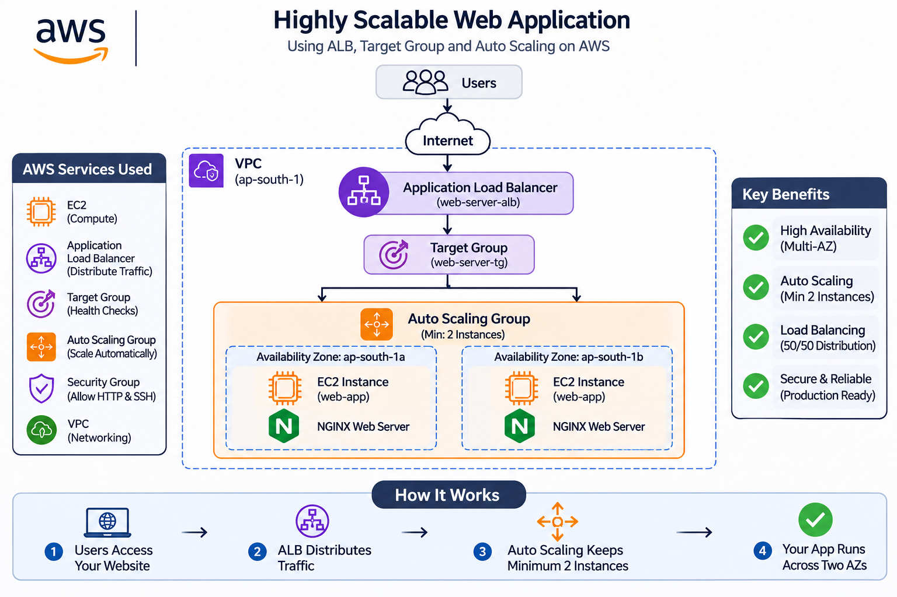
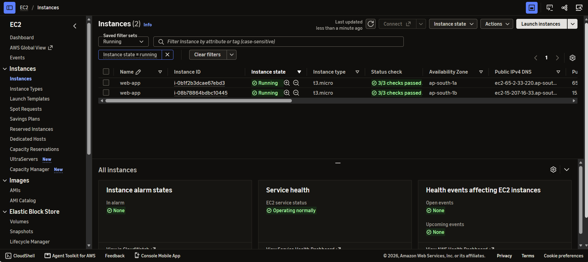
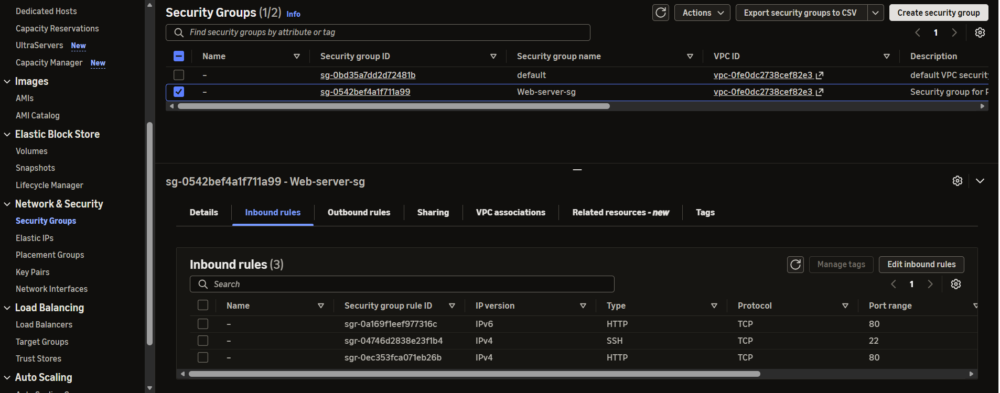
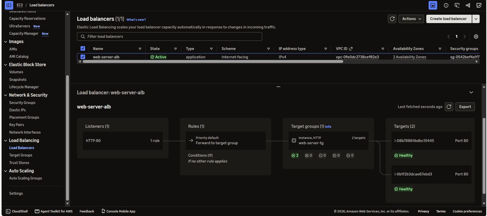
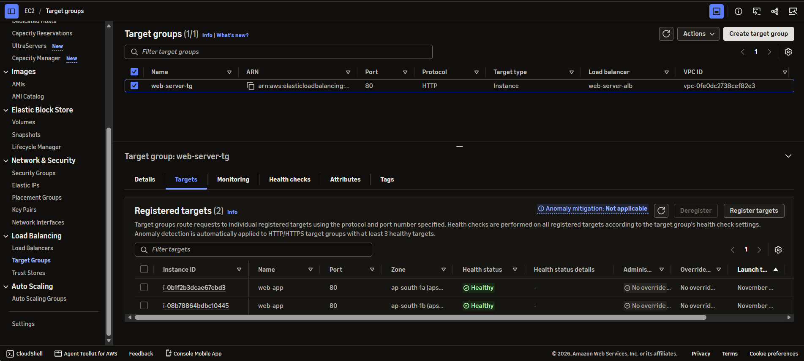
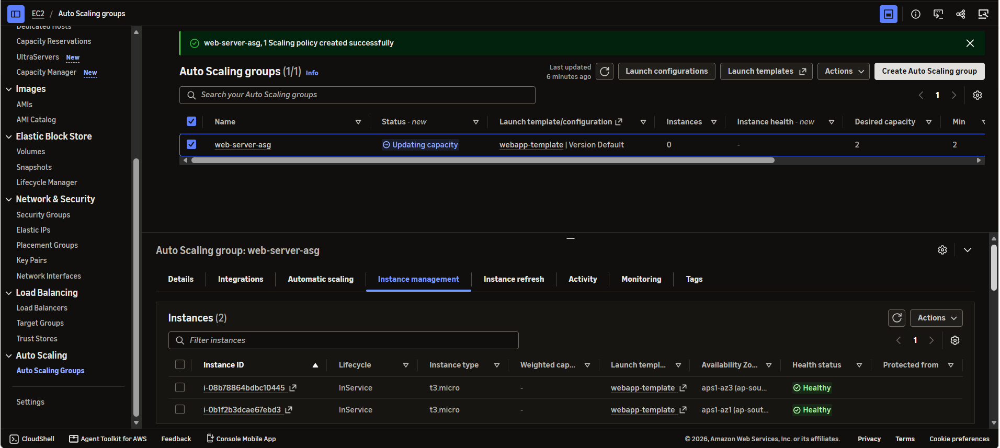
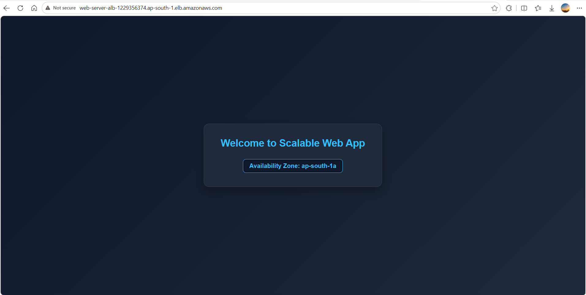
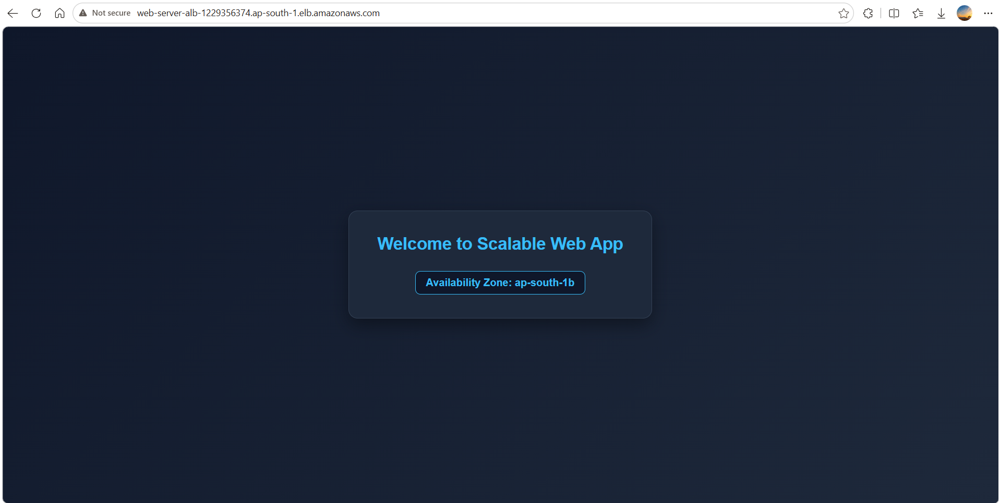

# 🚀 Scalable Web Application on AWS

<p align="center">
  A production-inspired web infrastructure built using AWS Application Load Balancer and Auto Scaling.
</p>

<p align="center">
  
  
  
  
  
</p>

---

## 📌 Project Overview

This project demonstrates the deployment of a **highly available and automatically scalable web application on AWS** using an Application Load Balancer (ALB) and an Auto Scaling Group (ASG).

The infrastructure distributes incoming HTTP traffic across multiple EC2 instances deployed in two Availability Zones, improving application availability and eliminating a single point of failure at the compute layer.

Each EC2 instance runs an NGINX web server and dynamically identifies its Availability Zone using the **EC2 Instance Metadata Service Version 2 (IMDSv2)**.

An Auto Scaling Group maintains a minimum capacity of two instances and automatically adjusts the infrastructure based on CPU utilization using a **Target Tracking Scaling Policy**.

## 🏗️ Architecture

<p align="center">
  
</p>

### Architecture Highlights

- **Multi-AZ Deployment:** EC2 instances are distributed across two Availability Zones.
- **Traffic Distribution:** ALB routes incoming requests to healthy EC2 instances.
- **Automatic Scaling:** ASG adjusts the number of instances based on CPU utilization.
- **Health Monitoring:** Target Group health checks identify unhealthy instances.
- **Automated Provisioning:** EC2 User Data installs and configures NGINX automatically.

---

## ☁️ AWS Services & Technologies

| Service / Technology | Purpose |
|---|---|
| Amazon EC2 | Hosts the NGINX web application |
| Application Load Balancer | Distributes incoming HTTP requests |
| Target Group | Registers EC2 instances and performs health checks |
| Auto Scaling Group | Maintains and automatically adjusts instance capacity |
| Launch Template | Defines EC2 launch configuration |
| Amazon VPC | Provides isolated networking infrastructure |
| Security Groups | Controls inbound and outbound traffic |
| Availability Zones | Enables multi-AZ infrastructure deployment |
| NGINX | Serves the web application |
---

## ⚙️ Infrastructure Configuration

| Configuration | Value |
|---|---|
| AWS Region | ap-south-1 (Mumbai) |
| Operating System | Amazon Linux 2023 |
| Instance Type | t3.micro |
| Web Server | NGINX |
| Availability Zones | ap-south-1a, ap-south-1b |
| Load Balancer | Application Load Balancer |
| Listener | HTTP : 80 |
| Target Group | web-server-tg |
| Auto Scaling Group | web-server-asg |

## ✨ Core Features

| Feature | Implementation |
|---|---|
| High Availability | EC2 instances across two Availability Zones |
| Load Balancing | ALB with healthy target routing |
| Auto Scaling | CPU-based Target Tracking Policy |
| Fault Tolerance | Health checks and instance replacement |
| Dynamic Configuration | IMDSv2-based Availability Zone detection |
| Automated Deployment | EC2 User Data and NGINX installation |

---

## 🖥️ Deployment & Verification

### 01. Compute & Network Configuration

EC2 instances are deployed across multiple Availability Zones with security groups configured to control application traffic.

<p align="center">
  
  <br/>
  <em>EC2 instances deployed across two Availability Zones</em>
</p>

<p align="center">
  
  <br/>
  <em>Security Group inbound traffic configuration</em>
</p>

### 02. Application Load Balancer & Target Group

The Application Load Balancer receives HTTP requests and forwards them to registered EC2 instances through the Target Group.

<p align="center">
  
  <br/>
  <em>ALB resource map and traffic routing configuration</em>
</p>

<p align="center">
  
  <br/>
  <em>Target Group health checks and registered targets</em>
</p>

### 03. Auto Scaling Configuration

The Auto Scaling Group maintains the desired infrastructure capacity and uses CPU-based Target Tracking to automatically adjust the number of EC2 instances.

<p align="center">
  
  <br/>
  <em>Auto Scaling Group capacity and instance health</em>
</p>

### 04. Live Load Balancing Verification

The application dynamically displays the Availability Zone of the EC2 instance handling each request.

Refreshing the ALB DNS endpoint demonstrates requests being served by instances in different Availability Zones.

<table>
  <tr>
    <th align="center">Availability Zone A</th>
    <th align="center">Availability Zone B</th>
  </tr>
  <tr>
    <td align="center">
      
    </td>
    <td align="center">
      
    </td>
  </tr>
</table>

---

## 🔄 How It Works

1. Users access the application through the ALB DNS endpoint.
2. The ALB forwards incoming HTTP requests to the Target Group.
3. The Target Group distributes requests across healthy EC2 instances.
4. NGINX serves the application from the selected instance.
5. IMDSv2 retrieves instance metadata to display the active Availability Zone.
6. The Auto Scaling Group adjusts EC2 capacity according to CPU utilization.

---

## 📂 Repository Structure

```text
scalable-web-app-alb-asg/
│
├── architecture/
│   └── architecture.png
│
├── images/
│   ├── 01-ec2-instances.png
│   ├── 02-security-group.png
│   ├── 03-alb-overview.png
│   ├── 04-target-group.png
│   ├── 05-auto-scaling-group.png
│   ├── availability-zone-1a.png
│   └── availability-zone-1b.png
│
├── scripts/
│   └── user-data.sh
│
└── README.md
```

---

## 🧠 Key Learnings

This project provided hands-on experience with:

- Designing highly available AWS infrastructure.
- Implementing multi-AZ EC2 deployments.
- Configuring Application Load Balancers and Target Groups.
- Creating Launch Templates and Auto Scaling Groups.
- Implementing CPU-based Target Tracking Scaling Policies.
- Automating EC2 configuration using User Data.
- Working with NGINX and IMDSv2.
- Understanding health checks, traffic distribution, and fault tolerance.

## 👨‍💻 Author

**Aryan Singh**

Cloud Engineering Enthusiast | AWS | Linux | DevOps

- GitHub: [@aryansingh055](https://github.com/aryansingh055)

---

<p align="center">
  <strong>If you found this project useful, consider giving it a ⭐</strong>
  <br/><br/>
  Built with ☁️ AWS and a passion for Cloud Engineering.
</p>